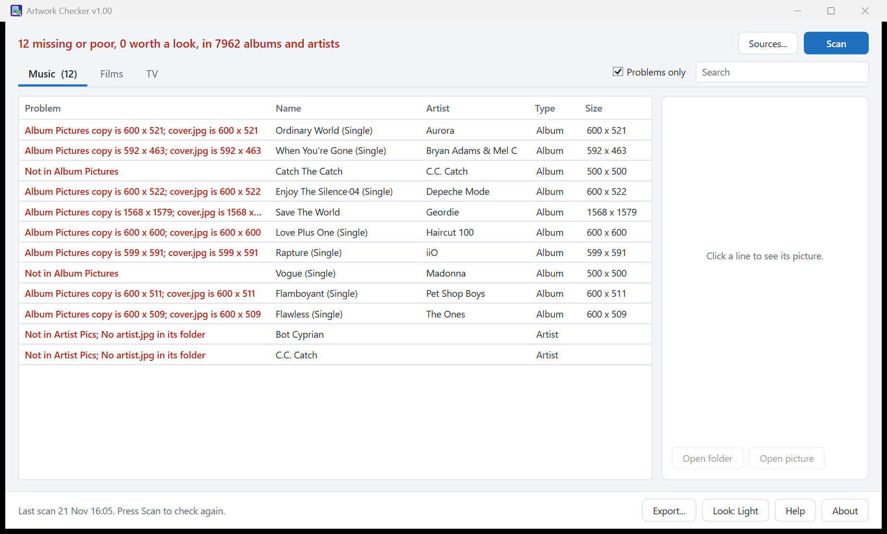

  

# Artwork Checker

Finds films, shows and albums with missing or low-quality posters and cover art.

    

## ✨ Features

Artwork Checker is a PowerShell/WPF tool that finds the albums, artists, films and shows whose pictures are missing or not right, both where the media lives and in your picture folders.

- **Music** (from your music folders): every album needs `cover.jpg` in its folder and a copy in `<picture folder>\Album Pictures\<Artist>\<Artist> - <Album>.jpg` (or a folder named like the music folder, such as `Compilations`; the name may end with the year), both exactly 500 x 500. Every artist needs `folder.jpg` in `<picture folder>\Artist Pics\<Artist>` and `artist.jpg` in its own folder, at any size. An album with no cover file whose tracks carry their own cover is marked as worth a look.
- **Films and TV** (from Jellyfin, Plex or Emby, where their posters are kept): every film, show and season is checked for a poster at least 600 pixels wide and poster-shaped, a background picture, and a saved copy in the picture folder's `Movies` or `TV` folder. **Save posters** copies the missing ones from the server.
- **Red, amber, green**: missing or too small, worth a look, fine. **Problems only** hides the fine ones; search finds an album, artist, film or show.
- **See the picture** on the right; open the folder (music) or the item's page in the server (films and TV) with a double-click.
- Only the first few bytes of each picture are read, so a scan of about 8,000 albums and artists on the NAS takes about four minutes, in the background. The last scan is kept for the next start; **Export...** saves the list as a CSV file, or the pictures as files in a folder you choose: on the Music tab the covers (and artist pictures) from your music folders, laid out like the picture folder (`Album Pictures\<Artist>\<Artist> - <Album>.jpg`, `Artist Pics\<Artist>\folder.jpg`); on the Films and TV tabs every poster (and background) from the server.
- Light and dark looks, Help and an About box.

## 🖼️ Screenshots

## 📋 Requirements

- Windows 10 or 11.
- Windows PowerShell 5.1 (built into Windows) with .NET Framework 4.7.2 or later.
- For films and TV: Jellyfin or Emby with an API key from its dashboard, or Plex with your Plex token.

## 📦 Installation

1. Download `Artwork-Checker-v1.02.zip` from the [latest release](../../releases/latest) and unzip it wherever you like to keep it.
2. Double-click **Artwork Checker.cmd** in the unzipped folder. It makes a **Artwork Checker** shortcut there and in the Start menu, and starts the tool. From then on, use the shortcut, the Start menu or a pinned taskbar button.

Nothing is installed and no Windows settings are changed. The shortcut runs the script with PowerShell's execution policy bypassed for that run only.

**From the repo:** clone it and double-click **Start Artwork Checker.cmd**.

### Why no exe

Home tools used to ship as PS2EXE exes, and antivirus programs (ESET among them) kept flagging those exes as generic trojans by mistake. A plain script and a shortcut give the same one-click start without the false alarms, and you can read exactly what runs.

### Build a release

Double-click **Build.cmd** in the repo folder. It reads `build.json`, checks every script for syntax errors and that `$script:AppVersion` matches the newest `CHANGELOG.md` entry (if the version lives in a file of its own, add `"VersionFile": "src\\<file>.ps1"` to `build.json`; that file can call it `$script:<Name>Version`), runs PSScriptAnalyzer if it's installed, copies the release files into `..\Builds\Artwork Checker v<version>\`, zips that folder for the GitHub release, refreshes `..\Builds\Artwork Checker.lnk` (what the Home Launcher starts) and scans the result with ESET's command-line scanner if it's installed.

## 🚀 Usage

1. Start Artwork Checker (the shortcut, the Start menu, or **Artwork Checker.cmd**).
2. Press **Sources...** to say where everything comes from: music from **This PC** or the **NAS**, each with its own folders (Windows' Music folder to begin with), and the music picture folder (the one with `Album Pictures` and `Artist Pics` in it); for films and TV, **Jellyfin**, **Plex** or **Emby**, its address and API key (or Plex token), and the picture folder for saved posters (with `Movies` and `TV` in it). **Test** checks the server answers. The names of the folders inside each picture folder can be changed to match yours. Then **Save**. **Remove folder...** takes a music folder off the list without touching its files.
3. Press **Scan** on the **Music** tab.
   For films and TV, press **Scan** on the **Films** or **TV** tab, then **Save posters** to copy the missing posters into the picture folder.
4. Click a line to see its picture; double-click to open its folder or its page in the media server. Fix it there, then scan again.

## ⚙️ Configuration

**Where settings live:** `%APPDATA%\Artwork Checker`. Nothing is written inside the repo or a release folder, so settings carry over to new versions.

- `settings.json`: the look, the music and picture folders, the sizes (cover 500 x 500, poster at least 600 pixels wide), and each media server's address and key (Jellyfin, Plex and Emby are kept apart, so switching loses nothing).
- `results.json`: the last scan, shown again at the next start.
- `Artwork Checker.log`: scans and anything that went wrong.

## 📝 Changelog

See [CHANGELOG.md](CHANGELOG.md).

## 📄 Licence

[MIT](LICENSE). Copyright (c) 2026 Jason Rhodes.

Created by Jason Rhodes, built with Claude (Anthropic).
